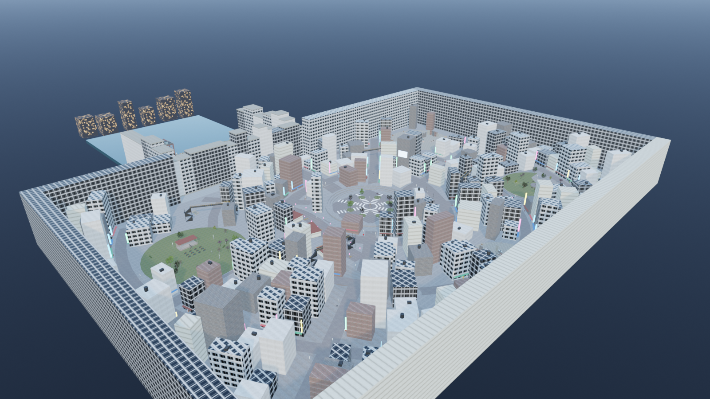
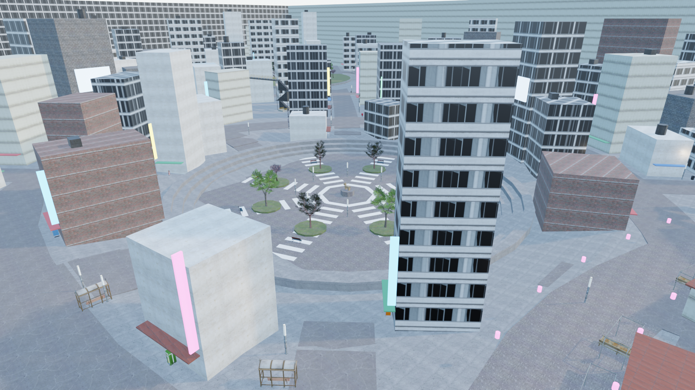
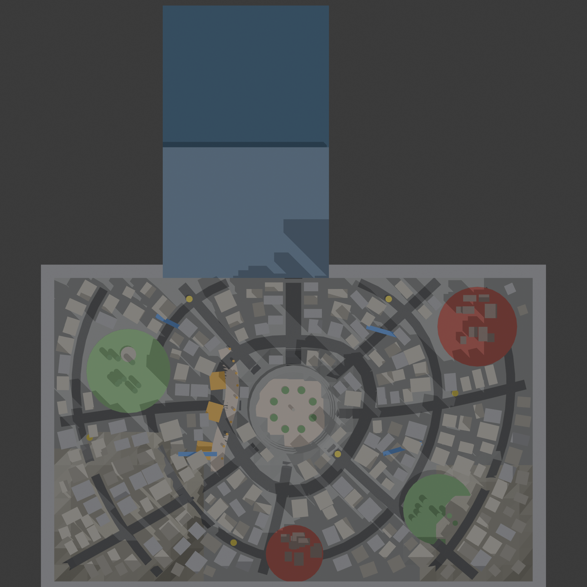
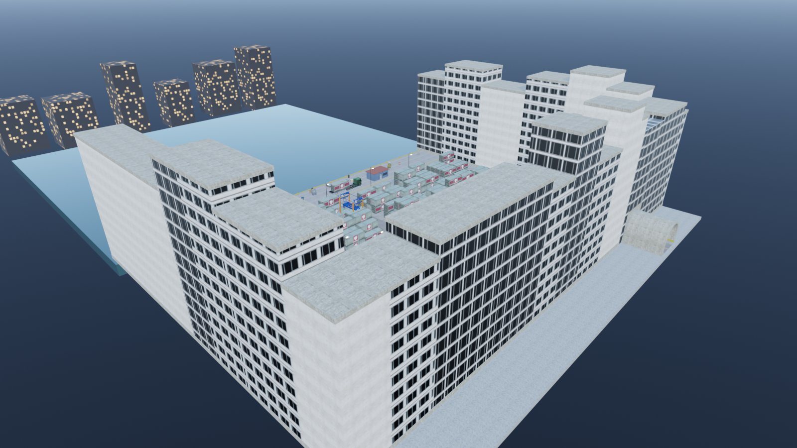

# Outils carte GMod ← Blender

Scripts Python pour **construire une carte Garry's Mod dans Blender, entièrement par code**, puis la **compiler en .bsp**.
Exemple fourni : un port industriel et un quartier inspiré de Shibuya (plan arrondi, relief, place en contrebas,
rue marchande, parcs, égouts, passerelles).



## Ce que ça fait

- **Construction procédurale dans Blender** (`blender/creer_*.py`) : boîtes, voûtes, escaliers, garde-corps, rues en courbe,
  relief, immeubles posés le long des rues, intérieurs.
- **Vrais modèles du jeu dans Blender** : import des `.mdl` Source avec l'extension [SourceIO](https://github.com/REDxEYE/SourceIO),
  posés à la bonne hauteur et dans le bon sens.
- **Export vers GMod** (`blender/exporter_gmod.py`) :
  - chaque objet convexe devient une brosse, avec la même texture et la même échelle que dans Blender
    (projection en boîte ou UV) ;
  - les modèles du jeu deviennent des `prop_static` ou des `prop_dynamic` ;
  - les lumières Blender deviennent des `light` ;
  - murs invisibles (`CLIP_*`), échelles (`LADDER_*`), eau, ciel calé automatiquement, points d'apparition, cubemaps ;
  - optimisation : seuls les gros volumes coupent la visibilité, tout le petit décor est en `func_detail`, les petits props
    disparaissent au loin, échelle de lumière large sur les grandes surfaces.
- **Matériaux** (`blender/textures_gmod.py`) : écrit les `.vtf` / `.vmt` maison (écrivain VTF 7.2 inclus, sans outil externe).
- **Compilation** (`source/compiler_port.sh`) : export → copie des modèles nécessaires → `vbsp` / `vvis` / `vrad`.

## Prérequis

- Garry's Mod (fournit `vbsp`, `vvis`, `vrad` et les contenus HL2 / CS:S), Blender 5.x, Python 3 avec `numpy`, `Pillow`, `vpk`.
- Extension Blender **SourceIO** (pour voir les modèles du jeu dans Blender).
- Facultatif : **NEOTOKYO°** (jeu gratuit sur Steam) pour les modèles de ville japonaise utilisés par l'exemple.

**Aucun contenu de jeu n'est fourni ici** (ni textures, ni modèles de Valve ou de NEOTOKYO) : les scripts les lisent
depuis **vos** jeux installés (`textures_jeu.py`, `extraire_modeles.py`, `copier_neotokyo.py`).

## Utilisation

Le dossier se place dans `garrysmod/addons/<nom>/` (les chemins vers les jeux sont relatifs à cet emplacement).

```bash
cd blender
python textures_jeu.py                                                        # textures de vos jeux -> textures_jeu/
blender -b --factory-startup --python creer_port_compact.py                    # -> port.blend
blender -b --factory-startup --python creer_shibuya.py                         # -> shibuya.blend (port + ville)
cd .. && NOM_CARTE=ma_carte BLEND=shibuya.blend VVIS_RAPIDE=1 bash source/compiler_port.sh   # -> maps/ma_carte.bsp
```

## Aperçus

| | |
|---|---|
|  |  |
|  | |

## Licence

Code sous licence MIT (voir `LICENSE`). Garry's Mod, Half-Life 2, Counter-Strike: Source et NEOTOKYO° appartiennent
à leurs auteurs respectifs ; ce dépôt n'en contient aucun fichier.
